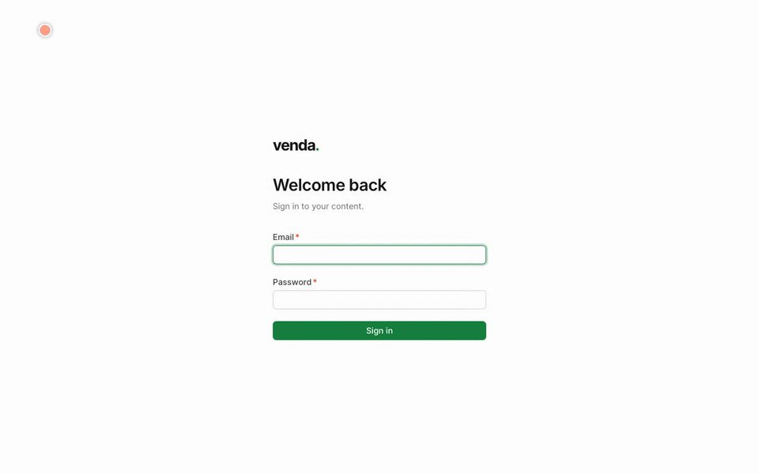

# Venda



Venda is a file-first, Cloudflare-native CMS. Content and data models are files: a folder per collection, a `config.ts` describing its fields, and a Markdown file per entry. They live in D1 with every version they have had, next to an index kept in the same write, and a typed content API serves them. Editors work in the admin; agents and developers work on the files through the API. The design is in [docs/architecture.md](docs/architecture.md); it is being built slice by slice on `main`.

## Repository

- `packages/content`: **`@venda/content`**, the file format: `config.ts` collection models read as data (never run), frontmatter, and Markdown with block tags to and from rich-text documents.
- `packages/contract`: **`@venda/contract`**, the HTTP API in Effect Schema (`HttpApi`), shared by the server and every client.
- `packages/core`: **`@venda/core`**, the domain in Effect: the content files, their revisions and index, working copies and the public reads (`/content`), and accounts (`/auth`), over one Drizzle database (`/database`; migrations in `packages/core/drizzle` from `pnpm --filter @venda/core db:generate`). Capability checks are compile-time proofs ([gdp-ts](https://github.com/rauchg/gdp-ts)) minted only in `src/auth/proofs/`; `test/mistakes.ts` lists code that must not compile.
- `packages/server`: **`@venda/server`**, the Nitro 3 host. `pnpm --filter @venda/server build` builds the Cloudflare Worker (D1 for content and everything else, KV for sessions). Locally it runs on workerd through `wrangler dev` with local D1. Migrations apply at startup.
- `packages/cli`: **`@venda/cli`**, the `venda` command: pull a site's content files into a folder, push changes back, history and restore, site settings and entries, over the files API with an API token. `pnpm venda --help` builds and runs it.
- `packages/richtext`: **`@venda/richtext`**, the rich-text document format: validation, a safe HTML renderer and plain-text helpers.
- `packages/nuxt`: **`@venda/nuxt`**, a Nuxt module any Nuxt 4 site can install to read Venda content (`useVendaCollection`, `useVendaEntry`, `<VendaContent>`). See [its README](packages/nuxt/README.md).
- `packages/admin`: **`@venda/admin`**, the browser SDK and the provisional plugin contract, with a typed client built from `VendaApi`.
- `packages/views-core`, `packages/pages-core`: the lazy screens (content and problems; people, invitations, tokens, account and join). They depend on the SDK, never on each other.
- `packages/preset-default`: composes the first-party plugins.
- `apps/admin`: **`@venda/admin-app`**, a Nuxt 4.6 static shell that the Nitro 3 host serves at `/admin/`, on the API's own origin. The Focus editor prototype is still at `/admin/prototypes/editor` until slice 3 promotes it.
- `apps/landing`: the Venda website, a Nuxt UI site built on `@venda/nuxt`.

## Content files

The files keep this layout in D1 and whenever they are exported or imported:

```
content/
  blog/
    config.ts        export default defineCollection({ name: 'Blog', kind: 'posts', fields: { … } })
    hello-world.md   YAML frontmatter for the fields, Markdown for the body
```

Entries are Markdown with GFM and block tags such as `<Callout tone="info">`, whose attributes must be plain data. A file that does not fit its model is recorded as a problem, with its line, and never served; drafts (`draft: true`) and entries dated in the future are not served either.

## API

Public:

- `GET /api/health`
- `GET /api/content/:collection`: published entries, newest first.
- `GET /api/content/:collection/:slug`: one published entry.
- `GET /api/join/:token` and `POST /api/join/:token` (`{ name, password }`): see and accept an invitation.
- `POST /api/auth/sign-in` (`{ email, password }`): sets the `venda_session` cookie.

Signed in (the session cookie, or `Authorization: Bearer <API token>`):

- `GET /api/auth/me`, `POST /api/auth/sign-out`, `POST /api/auth/password` (`{ current, next }`; ends your other sessions).
- `GET /api/users`, `PATCH /api/users/:id` (`{ role?, status?, name? }`): administrators only.
- `GET /api/invitations`, `POST /api/invitations` (`{ email, role }`), `DELETE /api/invitations/:id`: administrators only.
- `GET /api/tokens`, `POST /api/tokens` (`{ name }`; the secret is returned once), `DELETE /api/tokens/:id`: your own tokens; making one needs a signed-in session, not a token.
- `GET /api/admin/collections`, `GET /api/admin/collections/:collection/entries` (cursor-paged, `?q=` to search), `GET /api/admin/collections/:collection/entries/:slug`: what the admin shows. Administrators and editors see drafts and future-dated entries; authors and contributors see published entries only.
- `GET /api/admin/content-problems`: files that do not fit their model, with their line. Administrators only.
- `GET /api/admin/files`, `GET /api/admin/files/read?path=`: every content file's path, SHA and size, and one file's text. `GET /api/admin/files/revisions?path=` (`&before=<id>` for older): its versions, newest first; `GET /api/admin/files/revision?path=&sha=`: one version's text. `POST /api/admin/files` (`{ message, changes: [{ path, text | null, baseSha | null }] }`): writes up to 200 files at once, each from the SHA it was read at, all or none (`Conflict` names the first that moved). Administrators and editors.
- `POST /api/admin/import` (`{ files: [{ path, text }] }`): brings up to 200 files in over whatever is there, keeping unreadable ones as problems. Administrators only.

Entries come back as `{ collection, slug, publishedAt, data }`, with the rich-text field as a document. Errors are tagged JSON (`{ "_tag": "CollectionNotFound", ... }`) with one status code each. Roles are administrator, editor, author and contributor; administrators and editors see drafts in the admin (people and invitations stay administrator-only), and per-entry ownership arrives with the write path.

## The venda CLI

For developers, scripts and agents, with an API token (Account → API tokens):

```sh
pnpm venda login --url https://cms.example.com --token <token>   # or VENDA_URL and VENDA_TOKEN
pnpm venda pull ./content                  # the site's files, and the SHA each was pulled at
pnpm venda status ./content                # what changed here since
pnpm venda push ./content -m "Retitle"     # all of it in one write, or none
pnpm venda history journal/first-light.md  # every version; `show --at`, `restore --to`
pnpm venda site set name="Hill Notes"
pnpm venda entry set journal autumn --set title=Autumn --markdown body=autumn.md
```

A push from an old pull is refused whole, naming the file that moved: `venda pull` brings in the other changes (keeping yours), you merge, `venda resolve <path>`, and push again. Every command prints JSON with `--json` and exits non-zero on failure.

## Try the admin

Run `pnpm try`, open `http://localhost:8794` and open the admin. Sign in as
`owner@venda.local` / `try-venda-owner` (local only). Write and publish,
browse content and file problems, invite someone, manage people, change your
password, and create or revoke API tokens. Each screen is a lazy plugin, and
permissions stay enforced on the API.

An empty database gets `try/content` imported into it.

Between runs, `pnpm try` keeps:
- The local database (`.try/data`): your content and its revisions, the
  people and tokens you made, and your session.

It starts these fresh every time:
- The build and the logs.

`pnpm try --fresh` wipes the data too, so `try/content` is imported again.

`pnpm e2e admin` drives that same UI in a browser, including an invited author
in a private context, 390px screens and a thousand-entry collection.

## Configuration

- `VENDA_OWNER_EMAIL`, `VENDA_OWNER_PASSWORD` (required, at least 12 characters): the recovery owner, who always signs in as an active administrator. Rotate the password to recover access.
- `VENDA_VERSION` (optional): reported by `/api/health`.
- Workers bindings: `VENDA_DB` (D1: content, its index, people) and `VENDA_KV` (KV, sessions).

## Checks

```sh
pnpm format     # Prettier: formats every source file
pnpm lint       # Prettier check, ESLint in every package, then Oxlint (warnings denied)
pnpm typecheck  # tsc, plus Effect diagnostics in the Effect packages
pnpm test
pnpm build
pnpm fallow     # dead code, complexity and duplication in the gated packages
pnpm check      # lint + typecheck + test + fallow in one go
pnpm e2e        # live suites: the Worker built and run on local workerd and D1, with fixture content imported
pnpm try        # start it and open http://localhost:8794 to try each slice by hand (--fresh: wipe its data)
```

Prettier formats everything (`.prettierrc.json`, 80 columns); Markdown, content fixtures and generated files keep their authored shape (`.prettierignore`). Linting uses ESLint flat config for the blank-line rhythm and code rules, with `eslint-config-prettier` so the two never disagree. Shared rules live in `eslint.config.shared.mjs`; the Nuxt apps extend `@nuxt/eslint`'s `withNuxt()`, and the other packages use `typescript-eslint`. Packages listed in `tools/new-architecture.json` also get Oxlint's vendored anti-slop and Effect rules and the Fallow gate. Run `pnpm lint:fix` to format and auto-fix in one pass.
